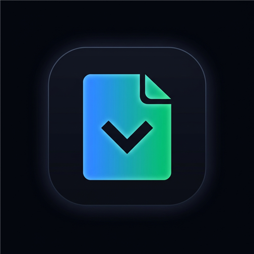
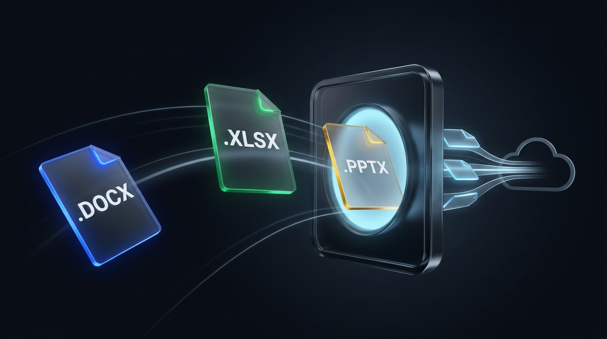

<div align="center">
  
  <h1>GDocsDrop</h1>
  <p><b>Instant Google Docs, Sheets &amp; Slides launcher for Windows Explorer — drop or double-click any Office file to open straight in your browser.</b></p>

  [](https://github.com/RamonRiosJr/GDocsDrop/releases/latest)
  [](https://github.com/RamonRiosJr/GDocsDrop/releases)
  [](#)
  [](https://github.com/RamonRiosJr/GDocsDrop/actions)
  [](LICENSE)
  [](CHANGELOG.md)
</div>

---

<div align="center">
  
</div>

## Overview

**GDocsDrop** fixes one of the most annoying Windows friction points when you live in Google Workspace without Microsoft Office installed: downloading `.docx`, `.xlsx`, or `.pptx` files gives you blank white icons and nowhere to open them.

Instead of spinning up a heavy Electron wrapper or managing separate OAuth tokens, **GDocsDrop** compiles to a single native Windows executable (`~340 KB`, zero external runtime installs) that works with your already-signed-in **Google Drive for Desktop** (`G:\My Drive`). Drop a file onto the dark-mode drop zone—or simply double-click it in Explorer—and GDocsDrop syncs, resolves the cloud ID via Drive's NTFS Alternate Data Streams, and launches Google Docs, Sheets, or Slides right in your browser.

---

## Key Features

- **Zero-Secret Cloud Sync**: Reuses your live Google Drive for Desktop session (`user.drive.id` & `user.drive.email` NTFS streams). No OAuth client secrets or tokens stored by the app.
- **Replaces Blank White Icons**: Registers per-user Windows file associations (`HKCU\Software\Classes`) with crisp Google Docs / Sheets / Slides icons—no Admin/UAC prompt required.
- **4 Frictionless Workflows**:
  1. **Double-click** any `.docx`, `.xlsx`, `.pptx`, `.odt`, `.ods`, `.odp`, or `.rtf` directly in Explorer.
  2. **Drag & drop** onto the `GDocsDrop` Desktop shortcut icon.
  3. **Dark-mode Drop Zone** window with multi-file support, Drive connection indicator, and clickable recent history.
  4. **Right-click → Send to → Google Docs (GDocsDrop)** for any document including `.pdf`, `.csv`, `.txt`, and `.md`.
- **SHA-256 Deduplication & Edit Preservation**: Tracks content hashes in `%LOCALAPPDATA%\GDocsDrop\history.json` so reopening the same file jumps straight to the existing Google Doc without duplicating it, while distinct files with matching filenames get a timestamp suffix instead of overwriting edits.
- **In-Place Drive Resolution**: Files already inside `G:\` open immediately with zero copying.
- **Multi-Account Safe**: Automatically appends `?authuser=<email>` from `:user.drive.email` so multi-account browsers land in the exact Google account that owns your Drive.

---

## Supported Formats

| Target App | Extensions |
| --- | --- |
| **Google Docs** (`/document/d/{id}/edit`) | `.docx`, `.doc`, `.docm`, `.dotx`, `.odt` |
| **Google Sheets** (`/spreadsheets/d/{id}/edit`) | `.xlsx`, `.xls`, `.xlsm`, `.xltx`, `.ods` |
| **Google Slides** (`/presentation/d/{id}/edit`) | `.pptx`, `.ppt`, `.pptm`, `.potx`, `.odp` |
| **Google Drive Viewer** (`/file/d/{id}/view`) | `.rtf`, `.csv`, `.txt`, `.md`, `.pdf`, and any other dropped file |

---

## Quick Start & Installation

1. Ensure **[Google Drive for Desktop](https://www.google.com/drive/download/)** is installed and mounted (default `G:\My Drive`).
2. Download **[`GDocsDrop-Windows.exe`](https://github.com/RamonRiosJr/GDocsDrop/releases/latest/download/GDocsDrop-Windows.exe)** from the [Releases](https://github.com/RamonRiosJr/GDocsDrop/releases/latest) page (or via [ramonrios.net/GDocsDrop](https://ramonrios.net/GDocsDrop)).
3. Run `GDocsDrop-Windows.exe` to open the dark Drop Zone window, and click **`File Icons & Double-Click`** in the footer if you want Windows Explorer to associate `.docx` / `.xlsx` / `.pptx` with GDocsDrop automatically.

### CLI Modes
```powershell
GDocsDrop-Windows.exe --register      # Register HKCU file icons & double-click handlers
GDocsDrop-Windows.exe --unregister    # Cleanly remove GDocsDrop file associations
GDocsDrop-Windows.exe "C:\path\file.docx"   # Quick bottom-right HUD open
```

---

## Building from Source

GDocsDrop requires **zero third-party SDKs or NuGet packages**. It compiles directly with Windows' built-in `.NET Framework 4.x` C# compiler (`csc.exe` — C# 5.0).

```powershell
git clone https://github.com/RamonRiosJr/GDocsDrop.git
cd GDocsDrop

# Portable build -> dist\GDocsDrop-Windows.exe + dist\SHA256SUMS.txt
powershell -ExecutionPolicy Bypass -File .\scripts\build.ps1

# Build + install to %LOCALAPPDATA%\Programs\GDocsDrop + register Explorer icons + create shortcuts
powershell -ExecutionPolicy Bypass -File .\scripts\build.ps1 -Install
```

---

## Uninstalling

```powershell
& "$env:LOCALAPPDATA\Programs\GDocsDrop\GDocsDrop.exe" --unregister
```
Then remove `%LOCALAPPDATA%\Programs\GDocsDrop`, `%LOCALAPPDATA%\GDocsDrop`, and the Desktop / Start Menu / SendTo shortcuts.

---

## Security & Privacy

See [SECURITY.md](SECURITY.md). GDocsDrop never stores credentials, reads no unrelated files, and includes automated Secret Guard & Gitleaks CI scanning.

## License

Distributed under the **MIT License**. See [LICENSE](LICENSE) for full details.
